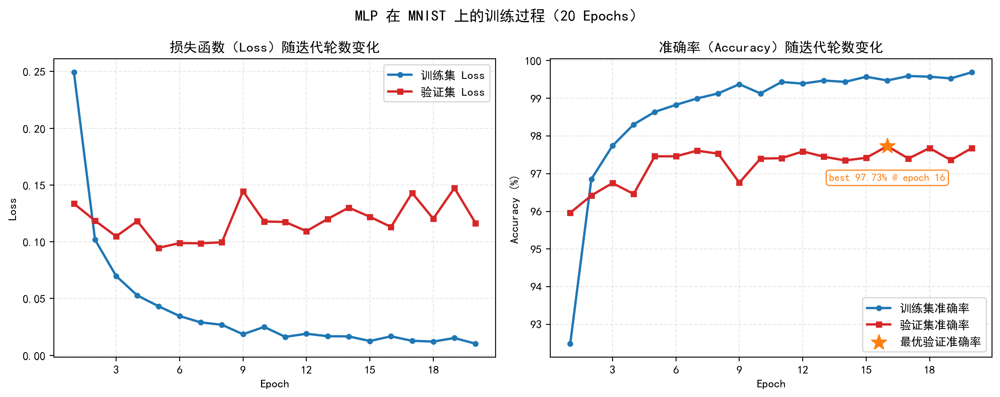
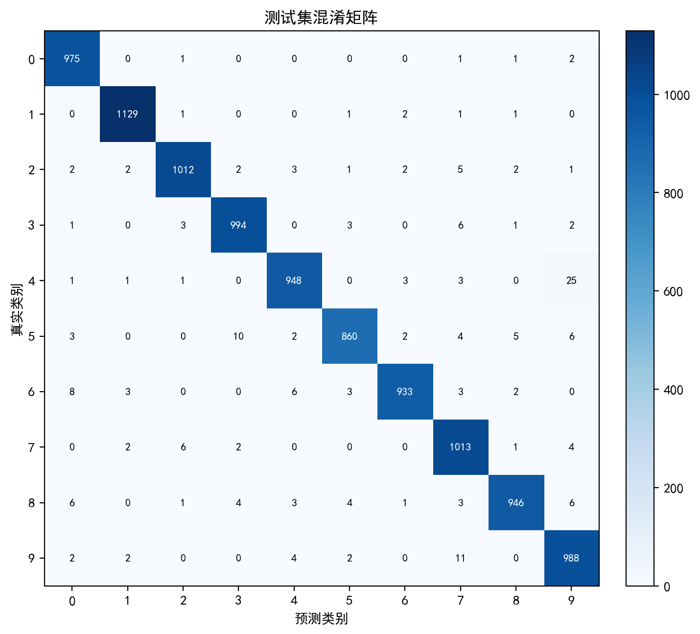
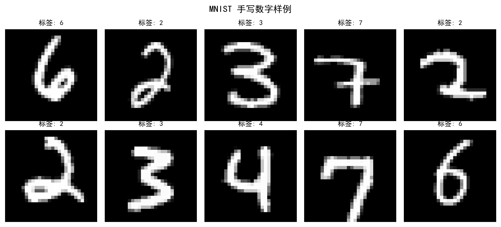
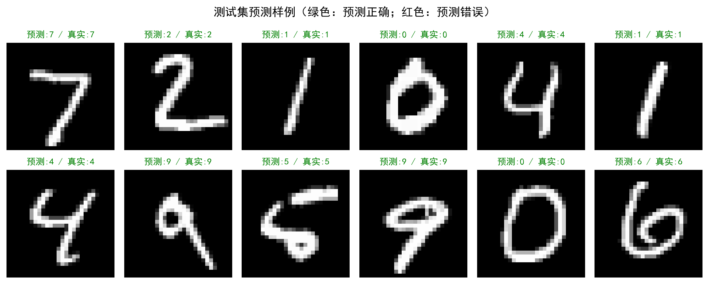

# 基于多层感知机（MLP）的 MNIST 手写数字识别

本仓库是实验的完整实现：从数据加载、模型定义，到 20 轮训练、验证、测试与可视化，
代码全部手写并逐行添加中文注释，实验结果（指标表、曲线图、混淆矩阵、预测样例）均已保存到 `results/`。

---

## 0. 实验结果速览

| 指标 | 结果 |
| --- | --- |
| 网络结构 | 784 → 256 → 128 → 10（全连接 + ReLU） |
| 可学习参数 | 235,146 |
| 训练轮数 | 20 |
| 最优验证准确率 | **97.73%**（第 16 轮） |
| 测试集准确率 | **97.98%**（Loss = 0.0996） |
| 训练总耗时 | 210.1 秒（RTX 4060 Laptop GPU，约 10.4 秒/轮） |
| 随机种子 | 42（可复现） |

---

## 1. 项目文件说明

```text
DPLN_HW/
├─ mnist_mlp.py            # 主程序：数据加载 → 模型定义 → 训练/验证 → 测试 → 绘图（含详细注释）
├─ plot_curves.py          # 附加脚本：读取 metrics.csv 重新画曲线，不必重新训练
├─ requirements.txt        # 依赖库及最低版本
├─ README.md               # 本文件：实验说明、结果与分析、报告素材
├─ data/MNIST/             # 数据集（首次运行自动下载，约 55 MB）
└─ results/                # 全部实验结果
   ├─ metrics.csv          # 20 轮训练集/验证集 loss 与准确率
   ├─ history.json         # 指标 + 超参数 + 测试结果的完整记录
   ├─ train_log.txt        # 训练日志（控制台输出原样保存）
   ├─ curves.png           # loss / 准确率迭代曲线（两张子图）
   ├─ samples.png          # MNIST 数据样例
   ├─ predictions.png      # 测试集预测样例（绿=正确，红=错误）
   ├─ confusion_matrix.png # 测试集 10×10 混淆矩阵
   └─ mlp_mnist.pth        # 验证集最优模型参数
```

---

## 2. 实验环境

| 项目 | 配置 |
| --- | --- |
| 操作系统 | Windows 10/11 64 位 |
| Python | 3.9.25（Anaconda，虚拟环境名 `env`，示例） |
| PyTorch | 1.12.0 + cu113 |
| torchvision | 0.13.0 + cu113 |
| 其他 | matplotlib、numpy |
| 硬件 | NVIDIA GeForce RTX 4060 Laptop GPU（8 GB 显存）；无 GPU 时程序自动改用 CPU |

环境已配置好，直接运行即可。若换一台电脑，可用以下命令创建环境：

```bash
conda create -n env python=3.9
conda activate env
pip install -r requirements.txt
# 如需 GPU 版 PyTorch，请按官网命令安装对应 CUDA 版本
```

---

## 3. 快速开始

```bash
# 激活环境（示例环境名为 env）
conda activate env

# 训练 20 轮并生成全部结果（首次运行会自动下载 MNIST）
python mnist_mlp.py

# 只根据已有结果重新画曲线（不重新训练）
python plot_curves.py

# 修改超参数，例如训练 10 轮、学习率 0.01
python mnist_mlp.py --epochs 10 --lr 0.01
```

程序运行结束后，所有指标写入 `results/metrics.csv` 和 `results/history.json`，
训练日志写入 `results/train_log.txt`，图片与模型保存在 `results/` 下。
在本机 GPU 上 20 轮约需 3.5 分钟；纯 CPU 也能跑完，只是更慢。

---

## 4. 实验原理

### 4.1 数据处理

MNIST 每张图片是 28×28 的灰度图，共 10 个类别（数字 0~9）。
预处理用 `transforms.Compose` 串联两步：

1. `ToTensor()`：PIL 图片 → `(1, 28, 28)` 的 float32 张量，像素从 [0, 255] 缩放到 [0, 1]；
2. `Normalize((0.1307,), (0.3081,))`：按通道做 `(x - mean) / std`，把输入变成近似零均值、单位方差，使梯度更稳定、收敛更快。

原始训练集 60000 张按 5:1 划分为 **训练集 50000 张 + 验证集 10000 张**，
官方测试集 10000 张只在最后评估时使用，避免"用测试集调参"造成结果偏乐观。
训练集 `shuffle=True` 每个 epoch 重新打乱，验证/测试集 `shuffle=False`。

### 4.2 多层感知机结构

```text
输入 (N, 1, 28, 28)
      │ Flatten
      ▼
   (N, 784)
      │ Linear(784 → 256) + ReLU
      ▼
   (N, 256)
      │ Linear(256 → 128) + ReLU
      ▼
   (N, 128)
      │ Linear(128 → 10)
      ▼
   (N, 10) 个 logits（0~9 的得分）
```

- 每个全连接层计算 `y = xW^T + b`，把上一层的特征线性组合成新的特征；
- ReLU 定义为 `f(x) = max(0, x)`，为网络引入非线性，同时缓解 Sigmoid 的梯度消失问题；
- 输出层不加激活函数，直接输出 10 个实数得分（logits），由交叉熵损失内部做 softmax。

参数量：784×256+256 = 200,960；256×128+128 = 32,896；128×10+10 = 1,290；合计 **235,146**。

### 4.3 损失函数与优化器

- 损失函数：`nn.CrossEntropyLoss()`，等价于 softmax + 负对数似然，
  公式为 `L = -log( exp(z_y) / Σ exp(z_j) )`；
- 优化器：Adam，学习率 1e-3。Adam 对每个参数自适应调整步长，收敛快、对学习率不敏感，适合作为默认选择；
- 每轮流程：前向传播算 loss → `optimizer.zero_grad()` 清梯度 → `loss.backward()` 反向传播 → `optimizer.step()` 更新参数。

### 4.4 训练与验证闭环

每个 epoch 先在训练集上"边训练边统计"平均 loss 与准确率，再在验证集上以 `model.eval()` + `torch.no_grad()` 评估一次。
验证集准确率创新高时保存模型参数（`mlp_mnist.pth`），训练结束后加载这份最优参数去测试集评估，
从而避免后期过拟合的模型影响最终结果。

---

## 5. 代码结构

| 文件 / 函数 | 作用 |
| --- | --- |
| `mnist_mlp.py::set_seed` | 固定 Python / NumPy / PyTorch 随机种子，保证结果可复现 |
| `build_dataloaders` | 定义 ToTensor + Normalize，加载 MNIST，划分 5:1 训练/验证集，构造 3 个 DataLoader |
| `MLP` | 继承 `nn.Module`，定义 fc1 / fc2 / fc3 与 `forward` 前向传播 |
| `train_one_epoch` | 一个 epoch 的训练循环：前向、算损失、反向传播、更新参数、累计指标 |
| `evaluate` | 验证/测试循环，`@torch.no_grad()` 关闭梯度，可返回预测结果用于混淆矩阵 |
| `plot_curves` | 画训练集/验证集 loss 与准确率曲线，标出最优验证准确率 |
| `plot_samples` / `plot_predictions` | 展示数据样例与测试集预测对错 |
| `plot_confusion_matrix` | 画 10×10 混淆矩阵热力图 |
| `main` | 串起数据、模型、训练、测试、保存结果、画图的完整流程 |
| `plot_curves.py::load_history` | 从 `metrics.csv` 读回指标，配合 `plot_curves` 重新画图 |

代码特点：

- 全部手写同时用ai规范保持代码可读，没有调用现成的训练框架封装；
- 关键步骤均有中文注释（数据变换、forward、zero_grad/backward/step、train/eval 模式、反标准化等）；
- 关键超参数用 `argparse` 暴露为命令行参数，方便重复实验；
- 训练日志、指标、模型、图片全部落盘，实验过程可追溯。

---

## 6. 实验步骤

1. **配置环境**：使用 Anaconda 的 `env`（示例）环境（Python 3.9 + PyTorch 1.12 + torchvision 0.13），确认 `torch.cuda.is_available()` 为 True。
2. **准备数据**：用 `torchvision.datasets.MNIST` 下载并加载数据集，`ToTensor` + `Normalize(0.1307, 0.3081)` 预处理；将 60000 张训练图按 5:1 划分为训练集与验证集，用 `DataLoader` 以 batch_size=64 批量读取，训练集打乱。
3. **搭建模型**：继承 `nn.Module` 定义三层全连接网络 784→256→128→10，隐藏层后接 ReLU，并在 `forward` 中依次完成展平、两次"全连接+激活"和输出层计算。
4. **设置训练要素**：损失函数用交叉熵 `CrossEntropyLoss`，优化器用 Adam（lr=1e-3），batch_size=64，共训练 20 轮。
5. **训练与验证**：每轮遍历训练集完成前向传播、损失计算、反向传播和参数更新；随后在验证集上计算 loss 与准确率，逐轮记录到日志和 CSV；验证准确率创新高时保存模型。
6. **测试评估**：训练结束后加载验证集最优模型，在 10000 张测试集上计算 loss、准确率、每个数字的召回率和 10×10 混淆矩阵。
7. **结果可视化**：绘制 loss/准确率迭代曲线、MNIST 样例图、预测样例图和混淆矩阵，并保存到 `results/` 目录。

---

## 7. 实验结果

### 7.1 20 轮训练指标

| 轮次 | 训练 Loss | 训练准确率 | 验证 Loss | 验证准确率 |
| ---: | ---: | ---: | ---: | ---: |
| 1 | 0.2493 | 92.48% | 0.1336 | 95.96% |
| 2 | 0.1018 | 96.86% | 0.1186 | 96.42% |
| 3 | 0.0698 | 97.74% | 0.1047 | 96.75% |
| 4 | 0.0527 | 98.31% | 0.1182 | 96.46% |
| 5 | 0.0432 | 98.64% | 0.0946 | 97.46% |
| 6 | 0.0345 | 98.83% | 0.0988 | 97.46% |
| 7 | 0.0290 | 99.00% | 0.0986 | 97.61% |
| 8 | 0.0269 | 99.13% | 0.0995 | 97.53% |
| 9 | 0.0185 | 99.37% | 0.1445 | 96.76% |
| 10 | 0.0250 | 99.13% | 0.1179 | 97.40% |
| 11 | 0.0162 | 99.43% | 0.1174 | 97.41% |
| 12 | 0.0190 | 99.39% | 0.1094 | 97.59% |
| 13 | 0.0168 | 99.47% | 0.1200 | 97.45% |
| 14 | 0.0166 | 99.44% | 0.1301 | 97.35% |
| 15 | 0.0126 | 99.57% | 0.1220 | 97.42% |
| 16 | 0.0167 | 99.47% | 0.1130 | 97.73% |
| 17 | 0.0127 | 99.59% | 0.1430 | 97.40% |
| 18 | 0.0121 | 99.57% | 0.1203 | 97.68% |
| 19 | 0.0152 | 99.53% | 0.1473 | 97.36% |
| 20 | 0.0102 | 99.69% | 0.1164 | 97.68% |

（完整数据见 `results/metrics.csv`，训练日志见 `results/train_log.txt`。）

### 7.2 训练曲线



- 左图：训练集 loss 从 0.2493 一路降到 0.0102；验证集 loss 前 8 轮从 0.1336 降到 0.0986，之后在 0.11~0.15 之间波动并略有回升。
- 右图：训练集准确率从 92.48% 升到 99.69%；验证集准确率从 95.96% 快速升到 97.7% 左右后趋于平台，最高 97.73%（第 16 轮，图中星号标出）。

### 7.3 测试集结果

- 测试集 Loss = **0.0996**，准确率 = **97.98%**（10000 张中正确 9798 张）。
- 各数字召回率：

| 数字 | 0 | 1 | 2 | 3 | 4 | 5 | 6 | 7 | 8 | 9 |
| --- | ---: | ---: | ---: | ---: | ---: | ---: | ---: | ---: | ---: | ---: |
| 正确/总数 | 975/980 | 1129/1135 | 1012/1032 | 994/1010 | 948/982 | 860/892 | 933/958 | 1013/1028 | 946/974 | 988/1009 |
| 召回率 | 99.49% | 99.47% | 98.06% | 98.42% | 96.54% | 96.41% | 97.39% | 98.54% | 97.13% | 97.92% |

### 7.4 混淆矩阵



对角线是预测正确的样本。最集中的错误是：**4 被预测成 9（25 张）**、**9 被预测成 7（11 张）**、
**5 被预测成 3（10 张）**，以及 **6 被预测成 0（8 张）**、7→2 和 3→7 各 6 张。
这些数字在手写时确实存在"竖线长短、圈口开合"等相似之处，符合直观。

### 7.5 数据样例与预测样例





预测样例中绿色为预测正确、红色为错误；本次展示的 12 张全部预测正确。

---

## 8. 结果分析

1. **收敛速度快**：前 5 轮训练 loss 从 0.249 降到 0.043、验证准确率从 95.96% 升到 97.46%，说明 Adam + 标准化后的数据能让 MLP 很快找到较好的参数区域；之后再训练主要是"精修"。
2. **验证准确率早期高于训练准确率是正常现象**：训练集准确率是整个 epoch 内"边更新参数边统计"的平均值，包含第 1 轮前期还比较差的参数；而验证集是在该轮参数全部更新完之后统一评估的，所以第 1 轮出现 92.48%（训练）< 95.96%（验证）。
3. **存在明显过拟合**：从第 9 轮开始训练 loss 继续降到 0.0102、训练准确率升到 99.69%，但验证 loss 反而在 0.11~0.15 间波动，验证准确率停在 97.4%~97.7%，训练集与验证集准确率差距扩大到约 2 个百分点。这是典型的"模型把训练集细节（包括噪声）也记住了"。
4. **保存最优模型起到了早停作用**：若直接用第 20 轮参数测试，验证 loss 已比最优轮高；加载第 16 轮的最优参数后，测试准确率达到 97.98%，比最优验证准确率还略高，属于正常抽样波动。
5. **错误集中在形近数字**：混淆矩阵显示 4↔9、5↔3、9↔7、6↔0 是主要错误来源，与人类识别这些手写数字时的困难一致；而 0、1 的召回率接近 99.5%，因为它们的形状最简单、类内差异小。

---

## 9. 总结

### 心得体会

- **为什么隐藏层用 ReLU 而不是 Sigmoid？**
  ReLU 在正区间梯度恒为 1，能缓解深层网络的梯度消失；计算只有一次比较，速度快；输出稀疏（约一半神经元为 0），一定程度上减少冗余。Sigmoid 两端饱和、梯度接近 0，层数一多就容易学不动。
- **为什么要做 Normalize？**
  把像素缩放到零均值、单位方差后，各维输入尺度一致，损失曲面更"圆"，梯度下降/Adam 更容易收敛；同时避免大像素值主导梯度。
- **为什么输出层不加 softmax？**
  `CrossEntropyLoss` 内部已经包含 `log_softmax`，输出层直接给 logits 数值更稳定（避免 exp 溢出），也少一次重复计算。
- **为什么验证集准确率有时比训练集高？**
  训练集指标是 epoch 内所有 batch 的平均（含参数尚未更新的早期 batch），验证集指标是 epoch 结束后用最终参数算的；另外训练时的数据顺序、增强等也会带来差异。第 1 轮最明显，后面训练准确率就反超了。
- **如何判断过拟合？**
  训练 loss 持续下降、训练准确率持续上升，而验证 loss 止跌回升、验证准确率停滞，两者差距越来越大。本实验从第 9 轮开始出现这一现象。

###  改进意见

1. **加正则化**：在全连接层后加 `Dropout(0.2~0.5)`，或给 Adam 设置 `weight_decay=1e-4`，抑制过拟合。
2. **早停（Early Stopping）**：验证 loss 连续若干轮不下降就停止训练，本实验在第 16 轮左右即可停。
3. **改用 CNN**：MLP 先把 28×28 展平成 784 维，丢失了像素的二维空间结构；用 2~3 层卷积 + 池化通常可把准确率提高到 99% 以上。
4. **数据增强**：对训练图做小角度旋转、平移、缩放，能提升对手写风格差异的鲁棒性。
5. **学习率调度**：使用 `StepLR` 或余弦退火，在训练后期减小学习率，让 loss 更平稳地收敛。
6. **模型集成**：训练多个不同初始化的 MLP 投票，可再涨 0.1%~0.3%。

---

## 10. 复现说明与常见问题

- **结果能否复现？** 代码固定了 `seed=42`，数据划分也固定；GPU 上 cuDNN 的部分算子有非确定性，重跑结果可能有 ±0.1% 的波动，属正常现象。
- **MNIST 下载失败？** 数据默认下载到 `data/`。若网络不通，可手动下载 4 个 idx 文件放到 `data/MNIST/raw/`，或改用镜像源。
- **没有 GPU 怎么办？** 程序会自动检测，`cuda` 不可用时退回 CPU；也可以显式指定 `--device cpu`。CPU 上 20 轮大约需要几分钟到十几分钟。
- **图片中文显示为方块？** 代码已设置 `SimHei` / `Microsoft YaHei` 字体；若系统没有这些字体，安装中文字体或在 `plt.rcParams` 中换成可用字体即可。
- **只想改轮数/学习率？** 直接加参数，例如 `python mnist_mlp.py --epochs 10 --lr 0.01`，结果会覆盖写入 `results/`。
- **不想重新训练、只想换图？** 运行 `python plot_curves.py`，它从 `metrics.csv` 读数据重画曲线。

